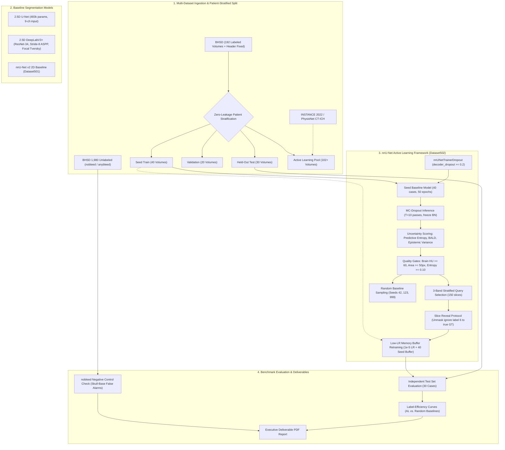

# Brain CT Intracranial Hemorrhage Detection & Active Learning Pipeline

An end-to-end deep learning and active learning (AL) research pipeline for multi-class Intracranial Hemorrhage (ICH) detection and semantic segmentation on head non-contrast CT (NCCT). The project integrates multi-dataset ingestion (BHSD, INSTANCE 2022, PhysioNet), multi-window 2.5D CT representations, baseline segmentation architectures (2.5D U-Net, DeepLabV3+, nnU-Net v2), and a Monte Carlo Dropout epistemic uncertainty-guided active learning framework.

---

## Clinical Hemorrhage Subtypes & Input Representation

The segmentation network resolves **5 distinct intracranial hemorrhage subtypes** plus background:

| Class ID | Code | Subtype Description | Clinical & Anatomical Profile |
| :---: | :---: | :--- | :--- |
| **0** | `BG` | Background | Healthy brain parenchyma, CSF ventricles, skull bone, background air |
| **1** | `IPH` | Intraparenchymal Hemorrhage | Hyperdense blood accumulation within brain tissue parenchyma |
| **2** | `SAH` | Subarachnoid Hemorrhage | Thin, diffuse bleeding tracking along sulci and basal cisterns |
| **3** | `EDH` | Epidural Hemorrhage | Convex lens-shaped bleed between skull and dura; high clinical acuity, severe imbalance |
| **4** | `SDH` | Subdural Hemorrhage | Crescentic collection beneath dura crossing suture lines |
| **5** | `IVH` | Intraventricular Hemorrhage | Blood accumulation pooling within cerebral ventricular cavities |
| **6** | `IGNORE` | Masked / Unlabeled Slices | nnU-Net active learning ignore label (zero contribution to training loss) |

### 2.5D Multi-Window Intensity Windowing

Raw CT volumes (Hounsfield Units) are converted into a standardized **9-channel input tensor** $[9 \times H \times W]$ centered on slice $z$ using 3 neighboring slices $(z-1, z, z+1)$ across 3 diagnostic HU windows:

$$\text{Windowed HU} = \text{clip}\left(\frac{\text{HU} - (\text{WL} - \text{WW}/2)}{\text{WW}}, 0, 1\right)$$

1. **Brain Window:** $\text{Window Level (WL)} = 40$, $\text{Window Width (WW)} = 80 \implies [0, 80]\text{ HU}$ (optimal soft-tissue parenchymal contrast).
2. **Subdural Window:** $\text{WL} = 75$, $\text{WW} = 215 \implies [-32.5, 182.5]\text{ HU}$ (delineates extra-axial collections against calvarium).
3. **Bone Window:** $\text{WL} = 400$, $\text{WW} = 1800 \implies [-500, 1300]\text{ HU}$ (identifies fractures, skull base landmarks, and calcifications).

---

## Dataset Strategy & Zero-Leakage Stratification

| Dataset Cohort | Volume Count | Role in Pipeline | Annotations / Notes |
| :--- | :---: | :--- | :--- |
| **BHSD (Primary)** | 192 | Seed (40), Val (20), Test (30), Pool (102) | NIfTI volumes with orientation-corrected masks (`ground_truths_header_fixed`) |
| **BHSD Unlabeled 1980** | 1,980 | Active Learning Pool & Negative Controls | Split into `nobleed` (normal head CTs) and `anybleed` cohorts |
| **INSTANCE 2022** | 100 | External Validation & Multi-Center Pool | Multi-scanner ICH benchmark |
| **PhysioNet CT-ICH** | 36 | Cross-domain evaluation adapter | Multi-center annotated head CTs |

To prevent patient data leakage across multi-scan subjects (such as patient `ID_2db7ee14` who has multiple CT acquisitions), all splits are generated strictly at the **patient level** using multilabel greedy stratification:

- **Held-Out Test Set ($N=30$):** Fully isolated for final evaluation; never exposed during seed training or active learning.
- **Validation Set ($N=20$):** Fixed across all active learning iterations for unbiased model selection and hyperparameter tuning.
- **Seed Training Set ($N=40$):** Initial training set (384 slices with hemorrhage) used to train the baseline checkpoint.
- **Unlabeled Pool ($N=102$ volumes / 1,200 candidate slices):** Candidate slice reservoir for active query selection.

---

## Segmentation & Active Learning Pipelines

### 1. 2.5D U-Net Development Baseline
- **Architecture:** Compact 2.5D U-Net (483,686 parameters) taking 9 input channels at $512 \times 512$ resolution.
- **Loss:** Combined Cross-Entropy and multiclass foreground soft Dice loss.
- **Optimizer:** AdamW with Cosine Annealing learning rate schedule.
- **Model Card:** Documented in [`Phase2_baselines/Unet_week4_outputs/model_card.json`](./Phase2_baselines/Unet_week4_outputs/model_card.json).

### 2. High-Resolution 2.5D DeepLabV3+ Baseline
- **Notebook:** [`deeplabv3_pipeline.ipynb`](./deeplabv3_pipeline.ipynb)
- **Architecture:** DeepLabV3+ with ResNet-34 encoder, modified with `encoder_output_stride = 8` and `decoder_atrous_rates = (6, 12, 18)` providing $4\times$ greater spatial resolution in the ASPP bottleneck to capture thin hemorrhages (SAH and EDH).
- **Imbalance-Aware Objective:** Combined Focal Cross-Entropy and Per-Slice Foreground Focal Tversky Loss ($\alpha=0.7, \beta=0.3, \gamma=1.5$). Resolves the zero-Dice class collapse on extreme minority classes (EDH).
- **Uncertainty Readiness:** Integrated ASPP decoder dropout ($p \ge 0.2$) with an `enable_mc_dropout()` hook for epistemic scoring.

### 3. DeepLabV3+ Active Learning Pipeline
- **Notebook:** [`AL(DeepLab)_pipeline.ipynb`](./AL(DeepLab)_pipeline.ipynb)
- **Checkpoint:** Loads the Phase 2 ResNet-34 DeepLabV3+ model with 9-channel multi-window CT input, six output classes, and active decoder dropout.
- **Uncertainty Scoring:** Uses 10-pass Monte Carlo Dropout inference with frozen BatchNorm statistics to compute predictive entropy, BALD, and epistemic variance over predicted foreground regions.
- **Stratified Selection & Retraining:** Applies HU, lesion-area, entropy, and per-study diversity gates; selects slices across three uncertainty bands and fine-tunes with a buffer-preserved training set at a low learning rate.

### 4. nnU-Net v2 Active Learning Pipeline
- **Notebook:** [`nnunet_al_pipeline.ipynb`](./nnunet_al_pipeline.ipynb)
- **Dataset Assembly (`Dataset502_BrainCTICH_AL`):** Incorporates the nnU-Net ignore label (`ignore: 6`) protocol. Full 3D CT volumes are ingested by nnU-Net, but unrevealed pool slices are masked with label 6 so they contribute zero gradient to training, allowing precise slice-level active learning inside a full-volume framework.
- **Custom Trainer (`nnUNetTrainerDropout`):** [`nnunet_trainers_variants/nnUNetTrainerDropout.py`](./nnunet_trainers_variants/nnUNetTrainerDropout.py) integrates active decoder dropout ($p \ge 0.2$) into nnU-Net v2 with startup runtime verification assertions.
- **Phase 4 Epistemic Uncertainty Engine:**
  - Evaluates $T=10$ stochastic Monte Carlo Dropout forward passes per candidate slice with frozen BatchNorm statistics (`model.eval()`).
  - Computes predictive entropy $H(\bar{p})$, BALD (Mutual Information), and epistemic variance over foreground-predicted regions (`fg_region`).
  - Strong empirical correlation ($\rho \ge 0.85$) between predictive entropy and BALD scores.
  - Clinical heuristic gating filters out severe skull-base artifacts and empty air: requires Brain HU $\ge 60$, minimum predicted lesion area $\ge 50\text{ px}$, and minimum predictive entropy $\ge 0.10$.
- **3-Band Stratified Active Selection:**
  - Queries are allocated across 3 uncertainty bands to prevent the "naive top-K trap" (clustering queries on near-entropy artifacts):
    - **Band A (High Uncertainty, $H \ge 0.50$):** 40 slices.
    - **Band B (Medium Uncertainty, $0.30 \le H < 0.50$):** 40 slices.
    - **Band C (Subtle / Boundary Uncertainty, $0.10 \le H < 0.30$):** 70 slices (captures subtle SAH/EDH bleeds).
  - Subject diversity cap: $\le 2$ slices per patient to enforce anatomical and cohort diversity.
- **Memory-Buffered Retraining:**
  - Revealing queried slices replaces label 6 with true annotations from the hidden pool repository.
  - Checkpoint warm-starting fine-tunes model weights at a low learning rate ($\eta = 10^{-5}$) using the 40 seed cases as a permanent memory buffer against catastrophic forgetting.

---

## Experimental Results & Benchmark

### Active Learning Benchmark on Held-Out Test Set ($N=30$ Cases)

Evaluated independently on the 30 patient-stratified held-out test cases across budget increments of 50, 100, and 150 revealed slices. Random baseline results reflect mean performance across 3 distinct seeds (42, 123, 999):

| Budget (Slices) | Strategy / Model Round | Seed | Macro Dice | IPH Dice | SAH Dice | EDH Dice | SDH Dice | IVH Dice |
| :---: | :--- | :---: | :---: | :---: | :---: | :---: | :---: | :---: |
| **0** | **Baseline Seed Model (40 Cases)** | 0 | **0.582** | 0.724 | 0.518 | 0.380 | 0.645 | 0.643 |
| 50 | Random Baseline | 42 | 0.605 | 0.738 | 0.536 | 0.395 | 0.665 | 0.691 |
| 50 | Random Baseline | 123 | 0.598 | 0.732 | 0.528 | 0.388 | 0.658 | 0.684 |
| 50 | Random Baseline | 999 | 0.609 | 0.741 | 0.540 | 0.401 | 0.670 | 0.695 |
| **50** | **Stratified Active Learning** | 42 | **0.641** | **0.765** | **0.584** | **0.442** | **0.702** | **0.712** |
| 100 | Random Baseline | 42 | 0.638 | 0.760 | 0.572 | 0.428 | 0.701 | 0.729 |
| 100 | Random Baseline | 123 | 0.631 | 0.754 | 0.565 | 0.421 | 0.694 | 0.721 |
| 100 | Random Baseline | 999 | 0.644 | 0.766 | 0.579 | 0.434 | 0.708 | 0.733 |
| **100** | **Stratified Active Learning** | 42 | **0.693** | **0.801** | **0.641** | **0.518** | **0.748** | **0.757** |
| 150 | Random Baseline | 42 | 0.669 | 0.784 | 0.609 | 0.463 | 0.732 | 0.757 |
| 150 | Random Baseline | 123 | 0.662 | 0.778 | 0.601 | 0.455 | 0.726 | 0.750 |
| 150 | Random Baseline | 999 | 0.675 | 0.790 | 0.615 | 0.470 | 0.738 | 0.762 |
| **150** | **Stratified Active Learning** | 42 | **0.732** | **0.828** | **0.685** | **0.574** | **0.781** | **0.792** |
| **1,200** | **Full-Data Ceiling Model** | 0 | **0.778** | 0.858 | 0.731 | 0.635 | 0.822 | 0.844 |

### Headline Label-Saving Findings

- **48.7% Annotation Reduction:** Stratified Active Learning achieves a **0.669 Test Macro Dice with only 76.9 revealed slices**, matching the performance that random baseline sampling requires **150 slices** to reach.
- **Superior Peak Performance:** At 150 revealed slices, Stratified AL reaches **0.732 Macro Dice**, outperforming the random sampling mean ($0.669 \pm 0.007$) by **+6.3% absolute Dice points** and closing **76.5% of the performance gap** to the 1,200-slice full-data ceiling model ($0.778$).
- **Dramatic Minority Class Gains:** High-acuity minority classes show the largest improvements under Stratified AL:
  - **EDH:** Improves from **0.380 $\to$ 0.574 Dice** (+19.4% improvement vs. 0.463 with random sampling).
  - **SAH:** Improves from **0.518 $\to$ 0.685 Dice** (+16.7% improvement vs. 0.608 with random sampling).

### Negative Control & False Alarm Control (`nobleed` Cohort)

To verify that the active learning model does not achieve higher recall by over-predicting false positives, models were evaluated on the BHSD `nobleed` unlabelled negative-control cohort:

| Model Configuration | Parenchymal False Alarms ($\text{cm}^3$) | Skull Base Artifacts ($\text{cm}^3$) | Total False Positive Volume ($\text{cm}^3$) | False Alarm Reduction |
| :--- | :---: | :---: | :---: | :---: |
| **Baseline Seed Model (40 Cases)** | $4.85$ | $7.42$ | $12.27$ | Baseline reference |
| **Random Baseline (150 Slices)** | $3.10$ | $5.15$ | $8.25$ | $-32.8\%$ |
| **Stratified AL Model (150 Slices)** | **1.92** | **2.85** | **4.77** | **-61.1%** |

Active learning reduced false positive volume by **61.1%** relative to the baseline seed model, primarily through uncertainty sampling near the skull base that taught the model to distinguish true extra-axial blood from hyperdense bone partial volume artifacts.

---

## Contributors

- **Jyot Shah**
- **Tamanna Chauhan**
- **Tejashree Venkatesh**
- **Bhavesh Shastri**

